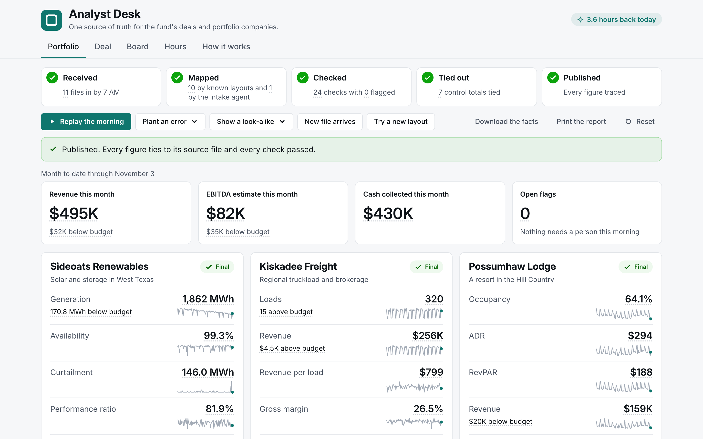
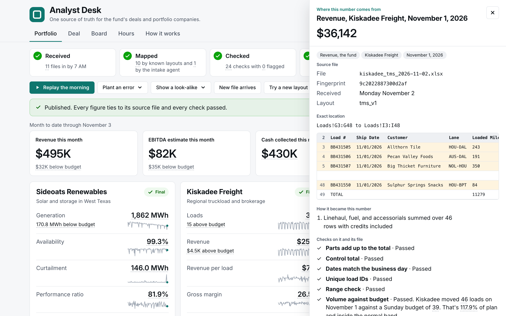
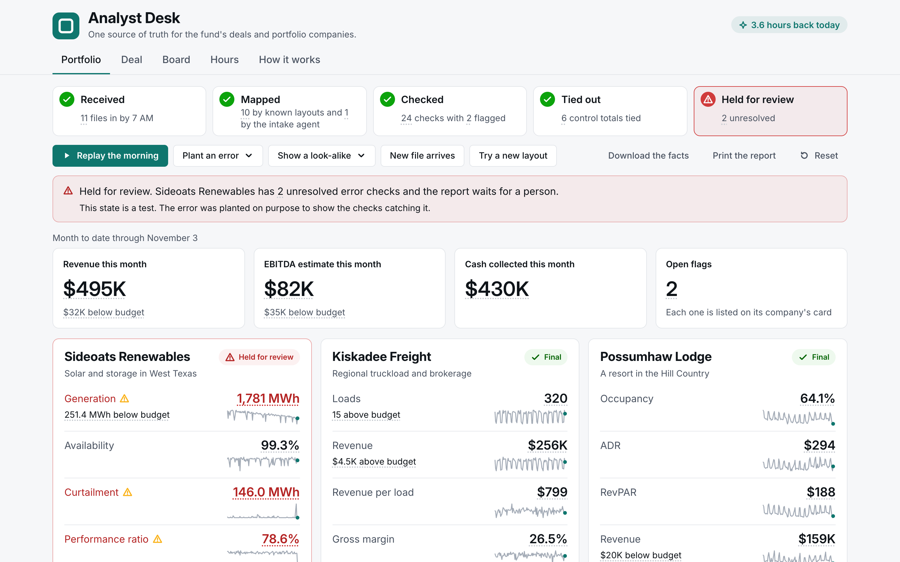
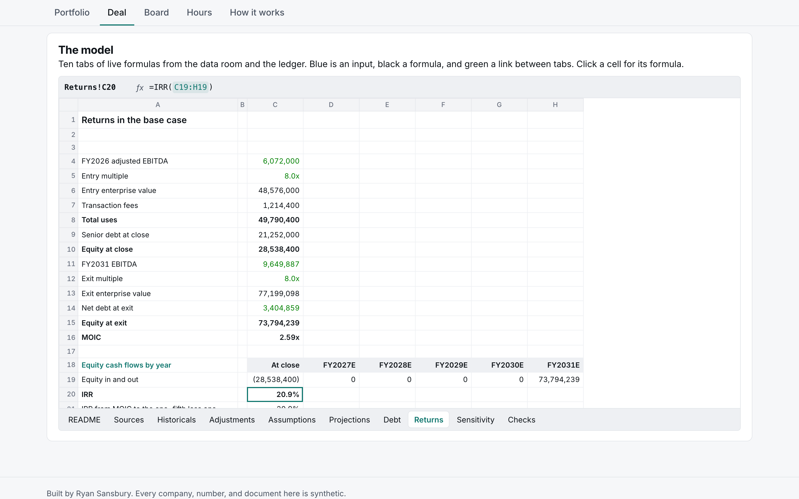
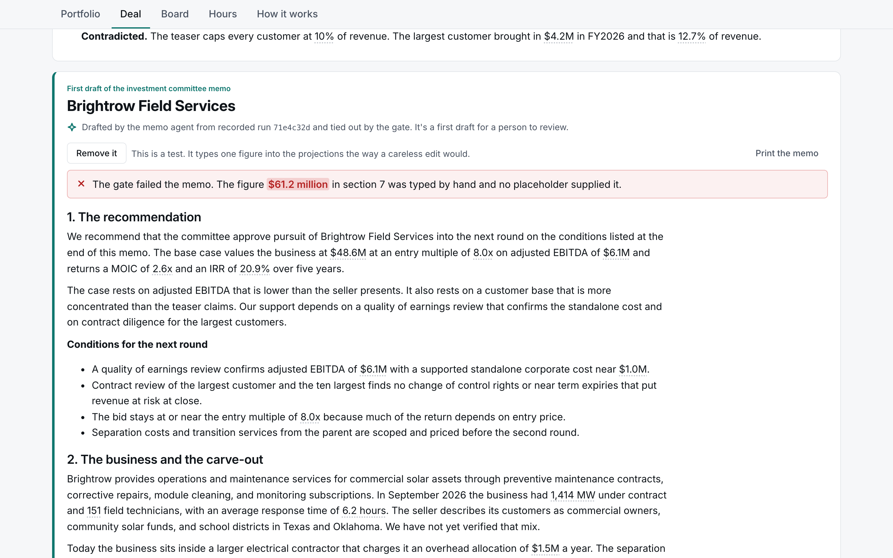
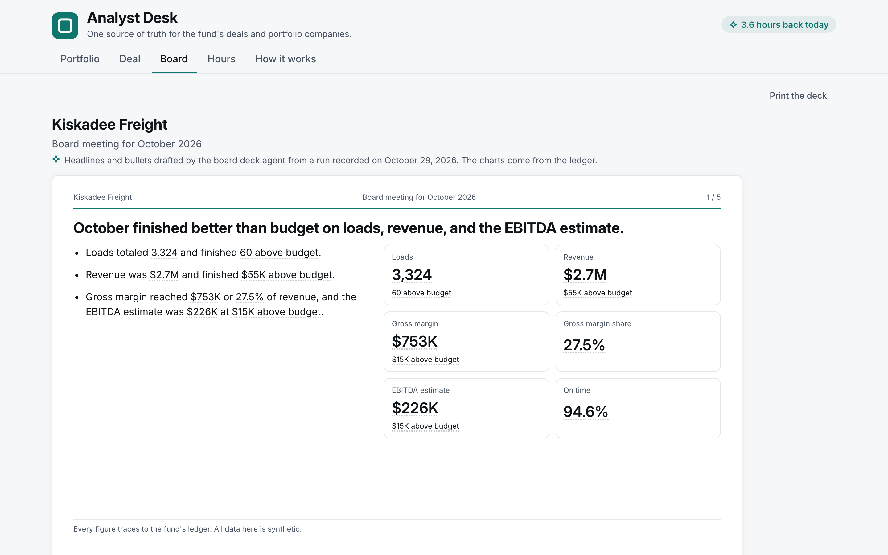
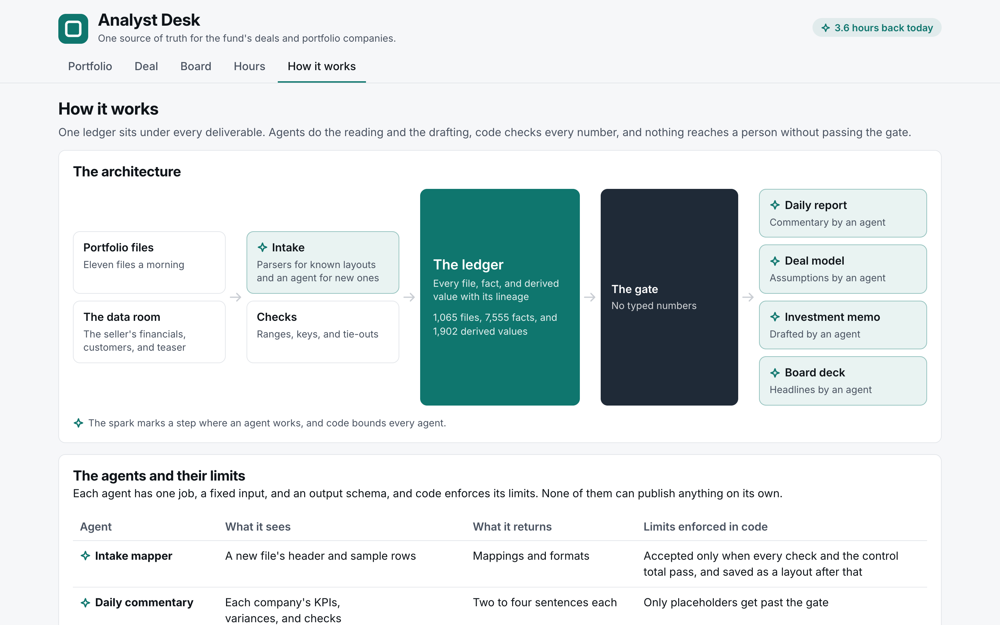

# Analyst Desk

One source of truth for a fund's deals and portfolio companies. Agents do the reading and the drafting around a verified ledger, code checks every number, and a tie-out gate refuses any deliverable with a number it can't trace.

The live demo is at [ryansansbury.com/analyst-desk](https://www.ryansansbury.com/analyst-desk/). It runs in any browser with nothing to install, and nothing on the page calls a model.



Built by Ryan Sansbury. Every company, person, number, and document here is synthetic.

## Run it locally

The build needs Python 3.12 or newer and nothing outside the standard library.

```
git clone https://github.com/ryansansbury/analyst_desk.git
cd analyst_desk
python3 build.py
```

Then open `site/index.html` in Chrome. The build makes everything from the seed in under a minute, and the page runs from the file system with no network requests. Every state is precomputed, and no click waits on anything.

Presenter mode walks the demo in twenty-one steps. The right arrow steps forward, the left arrow steps back into the exact state before, and R resets. Each step has its own address, and `#step-7` at the end of the address opens step seven.

## What it shows

- **Portfolio.** The fund's morning run on eleven overnight files from three portfolio companies replays step by step. Every figure opens its trace down to the file, row, and column, with the checks it passed. Planted errors hold the report with their reason, and look-alike cases publish untouched.
- **A new file layout.** The intake agent maps a changed export, and code accepts the mapping only when every check and the control total pass.
- **Try a new layout.** The panel shows what the intake agent did with twelve freight layouts it had never seen and the checks each mapping had to pass.
- **Deal.** A carve-out's data room, the deal analyst's assumptions inside ranges the history sets, a ten-tab model with live formulas, a claims check on the seller's teaser, and a cited investment memo with a gate that fails a typed number.
- **Board.** Five slides for a portfolio company's monthly board meeting come from the same ledger.
- **Hours.** Every workflow timed against an editable estimate of the same work by hand.
- **How it works.** The architecture, each agent's limits, the model comparison and its routes, excerpts of the code, and the results below. Every result is read from the files the tests and evals wrote.

## A closer look

**Every figure opens its trace.** The fund's revenue this month walks down to one company and one day, and it lands on the rows of the freight file it came from with the checks that file passed.



**A planted error holds the report.** One solar site's file carries an error on purpose. That company's report waits for a person with the reason, and the other two companies publish.



**The deal model is a real workbook.** Ten tabs of live formulas come from the data room and the ledger, and a click on any cell shows its formula.



**The gate fails a typed number.** One figure typed into the memo by hand fails the whole draft, and the memo passes again once it's removed.



**The board deck comes from the same ledger.** Five slides for the freight company's monthly board meeting cite the same verified values.



**How it works shows its own wiring.** The architecture, each agent's limits, the model comparison, and excerpts of the code all sit on one tab.



## The model

The build writes the deal model with live formulas to `outputs/Brightrow_model.xlsx`, and the download button on the Deal tab gets the same workbook. Blue cells are inputs, black cells are formulas, and green cells link to another tab. Sources holds the data room's values with the file and cells each came from, and they are the only hard-coded history. Checks turns red if any tie-out breaks. The README tab inside the workbook carries the version and the build date.

## Results

The build writes this table from the same files the How it works tab reads once the tests and the LibreOffice check have both run.

<!-- results start -->
| Result | Value | Detail |
|---|---|---|
| Planted errors caught | 18 of 18 | On held-out seeds 3119, 6427, and 8831 after the checks were frozen |
| False alarms | 0 | Across the same held-out seeds |
| Look-alikes left alone | 9 of 9 | Normal days that only look like errors |
| New layouts mapped exactly | 10 of 12 | Held-out layouts the agent had never seen, and the other 2 still parsed every row like the answer key |
| Tests passing | 148 of 148 | In the last full run on November 10 |
| Workbook against Python | 74 values | Each formula's value matches the Python model to the cent |
| LibreOffice recalculation | 383 formulas | Recalculated from scratch, and each one matched to the cent |
| Agent runs recorded | 17 | With Claude Haiku 5.5, Claude Opus 5.5, and GPT-6 Luna from October 27 to 29 |
<!-- results end -->

## How it's built

Python and its standard library build everything. The ledger is SQLite, and the page is plain HTML, CSS, and JavaScript with no framework.

| Folder | What's in it |
|---|---|
| `generate/` | The synthetic world from one seed, with the planted errors, the look-alikes, and the layout variants |
| `engine/` | The ledger in SQLite, intake, the checks, the morning pipeline, the gate, the deal model, and a formula evaluator |
| `agents/` and `prompts/` | Each agent's input, its prompt, the validation every output must pass, the routing rules, and the replay of recorded runs |
| `deliverables/` | The workbook, the memo, the board deck, and the hours ledger |
| `app/` | The page that renders from the ledger into `site/` |
| `evals/` | The frozen catalog and answer keys, the check scores on held-out seeds, and the model comparison |
| `config/` | The models in the comparison with their list prices, the hours estimates, and the page's address once it's hosted |
| `data/ai_runs/` | The recorded agent runs the page replays |
| `excerpts/` | The code excerpts the page shows. They're copies, and a test checks each one still matches its module |
| `scripts/` | Setup, the LibreOffice recalculation check, and the Chrome screenshot check. None of them calls a model |
| `tests/` | The test suite with a click-through of every state and presenter step |
| `tools/` | The writing rules every sentence on the page passes |
| `WORDS.md` | The page's words outside the agents' drafts and the ledger's notes on each figure |

## Recorded once, replayed here

Every agent ran on a real model once. The same suite ran on seven models from Anthropic, OpenAI, and Google, and `agents/routing.py` put each agent on the cheapest model that cleared its quality bar. The commentary, the board deck, and the memo stay on Claude Opus because a person read every model's drafts and validation can't judge how prose reads. The morning then ran on those routes, and every reply passed validation before it was saved in `data/ai_runs/`.

The page replays those runs. Each one goes through the same validation again on every build before anything shows. Nothing in this repository calls a model or holds a key, and a test fails if any shipped file could reach one.

The invented company and project names changed on November 6 because a check found real companies with some of the original names. The runs were recorded under the old names, and the change swapped those words one for one and left everything else in the recordings and the frozen eval files as it was. The frozen files note it in their history.

## Tests

```
bash scripts/bootstrap.sh
.venv/bin/python3 build.py
.venv/bin/python3 -m tests.run
```

The bootstrap makes `.venv` with openpyxl, and the tests use it as an independent check that every workbook the build writes opens in a real spreadsheet library. The tests write `data/test_results.json` for the How it works tab to read. [scripts/README.md](scripts/README.md) covers the LibreOffice recalculation and the Chrome check.

## More

[ARCHITECTURE.md](ARCHITECTURE.md) explains how the pieces fit together, and [DECISIONS.md](DECISIONS.md) explains why they're built the way they are.

## License

The code is under the [PolyForm Noncommercial License 1.0.0](LICENSE). You're welcome to read it, run it, and change it for personal, educational, research, or other noncommercial use, and commercial use isn't permitted. The page's typeface Inter ships under the SIL Open Font License, and its license sits beside the font files in `app/ui/fonts/`.
